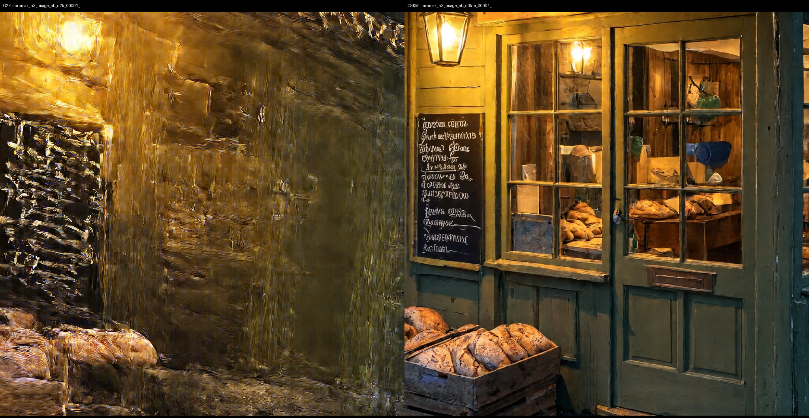

# MiniMax-H3-Image 本地部署（8GB 显存版）

一套在 **RTX 4070 Laptop · 8GB VRAM · 16GB 单通道 DDR5** 的 Windows 11 笔记本上
**实测跑通** MiniMax-H3-Image（含参考图编辑 / img2img）的最小可用配置。

仓库里只有我自己的配置、脚本和文档；**不含任何第三方权重**，权重用脚本从 ModelScope 拉。

---

## 为什么需要这个仓库

H3-Image 官方最低配是 `int8_convrot` DiT（21GB）+ `int8_convrot` 文本编码器（25.28GB），
按官方说明要 48GB 级显存才舒服。本机只有 8GB 显存、16GB 内存，官方组合直接出局。

本仓库的解法是**只砍 DiT 的量化档，不砍功能**：

| 组件 | 官方推荐 | 本仓库 | 原因 |
|---|---|---|---|
| DiT 主模型 | `minimax_h3_image_pruned_int8_convrot.safetensors`（21GB） | `MiniMax-H3-Image-Pruned-Q3_K_M.gguf`（**8.30GB**） | 唯一能塞进 8GB 显存还保得住纹理的档 |
| 文本编码器 | `qwen3vl_32b_minimax_h3_int8_convrot.safetensors`（25.28GB） | `qwen3vl_32b_minimax_h3_nvfp4_awq.safetensors`（**14.61GB**，官方原版） | 放 CPU 跑，给 DiT 让出显存 |
| 图像 VAE | `minimax_h3_image_vae_fp16.safetensors`（1.09GB） | 同（官方原版） | 没有更小的替代 |
| 提示词扩写器 | `qwen3.5_9b_w4a8_gptq.safetensors`（6.84GB） | **不装** | 16GB 内存装不下；图生图提示词改为手写"已扩写版" |

### 量化档怎么选（重要）

我实测了 2bit 的 `Q2_K` 和 3bit 的 `Q3_K_M`，**同提示词、同种子 42、同 2048²、同采样参数**，只换 DiT：



> 左 = Q2_K，右 = Q3_K_M。两块都是 1:1 无缩放裁切。
> **ComfyUI 界面里那个 768px 缩略预览看不出差别**，必须打开原图裁一块 1:1 看。

Q2_K 的构图和光照逻辑是对的，但像素层面是"油画刀刮"式的涂抹伪影：墙面变成一坨坨拖影、
面包边缘糊成块、砖缝麦穗木纹全部丢失。**2bit 已经把纹理毁了，采样步数和分辨率都救不回来。**

> ⚠️ 同 seed 在不同量化权重下**构图也会变**（潜变量轨迹不同），所以这是画质对比，不是像素差分。

**结论：Q3_K_M 是这个显存档位的下限。** 想更好只能换 24GB+ 显卡上 Q4_K_M / Q5_K_M。

---

## 目录结构

```
workflows/
  minimax_h3_image_t2i_q3km.json   文生图工作流（UI 格式，可直接拖进 ComfyUI）
  api_prompt_img2img.json          参考图编辑工作流（API 格式，可拖进 ComfyUI 展开）
docs/
  部署说明.md                      完整部署记录：版本、参数、踩坑、清理记录
  编辑原理.md                      参考图编辑是怎么工作的（官方规范 + 实现原理）
  提示词模板.md                    图生图提示词三段式模板 + 硬规则 + 范例
scripts/
  fetch_weights.ps1                从 ModelScope 拉权重并按字节数校验
  make_img2img_prompt.py           生成参考图编辑的 API 工作流
  validate_workflow.py             对着运行中的 ComfyUI 校验节点与下拉值
  run_test.ps1                     提交工作流并轮询出图
  compare_quant.py                 生成 1:1 对比裁切图
prompts/
  prompts_img2img.txt              图生图提示词范例（可直接复制）
  prompts_witch.txt                文生图 / 参考图编辑提示词范例
samples/
  cmp_q2k_vs_q3km.png              Q2_K vs Q3_K_M 的 1:1 对比
  q3km_bakery_1to1.png             Q3_K_M 输出的 1:1 原尺寸裁切
  reference_bakery.png             自带参考图（2048²），用来直接跑通图生图
```

---

## 快速开始

### 0. 前置

- ComfyUI **v0.45.0 或更高**（H3-Image 的 DiT / 采样器 / 条件节点是这版才进的）
- [ComfyUI-GGUF](https://github.com/leejet/ComfyUI-GGUF)（需要 2026-11-13 的 `ff8d486` 或更新）
- Python 依赖：`comfyui-workflow-templates >= 0.11.104`、`comfy-kitchen`、`comfyui-frontend-package`

### 1. 拉权重

```powershell
powershell -ExecutionPolicy Bypass -File scripts\fetch_weights.ps1 -Target ComfyUI\models
```

脚本会从 ModelScope 直链下载三个文件并**按精确字节数校验**（下错版本会被当场发现）：

| 文件 | 目录 | 字节数 |
|---|---|---|
| `MiniMax-H3-Image-Pruned-Q3_K_M.gguf` | `models/unet/` | 8,911,771,264 |
| `qwen3vl_32b_minimax_h3_nvfp4_awq.safetensors` | `models/text_encoders/` | 15,687,142,551 |
| `minimax_h3_image_vae_fp16.safetensors` | `models/vae/` | 1,168,505,312 |

> 权重**故意不进 git**（8.3GB 超过 GitHub 单文件 100MB 限制），所以给的是下载脚本。

### 2. 启动 ComfyUI

```bat
python ComfyUI\main.py --windows-standalone-build --reserve-vram 1.0 --lowvram --fast-disk --mmap-torch-files --preview-method none --port 8188
```

这几个参数是本机实测的必要组合：

- `--lowvram` + `--reserve-vram 1.0`：给 8GB 显存留出余量，DiT 放不下就卸载到内存
- `--fast-disk` + `--mmap-torch-files`：14.61GB 的 CPU 编码器靠 NVMe 分页托底（内存不够时靠磁盘换）
- `--preview-method none`：省掉预览图的额外采样开销

### 3. 出图

打开 <http://127.0.0.1:8188>，把 `workflows/minimax_h3_image_t2i_q3km.json` 拖进画布，改提示词，出图。

**采样参数固定，别改**：

```
sampler = euler    scheduler = simple    steps = 6    cfg = 1    denoise = 1
```

H3-Image 是 PDD 蒸馏模型，6 步网格是绑死的；`cfg > 1` 不生效（模型不支持 CFG 分支，也不支持负面提示词）。

**画布必须 ≥4MP**（2048×2048 或 1664×2560）。低于 4MP 模型自己就发糊——官方有效区间是 4–20MP，
理想值在 16MP 附近，但 16MP 本机带不动。

---

## 实测数据（RTX 4070 Laptop / 8GB VRAM / 16GB RAM）

| 项目 | 数值 |
|---|---|
| 2048×2048 单张耗时 | **约 7 分钟** |
| 其中 6 步采样 | **56 秒**（9.4 s/it） |
| 瓶颈 | CPU 文本编码 + 8.3GB 权重换入换出，**不是 GPU** |
| 显存 | 8188 MiB 总量，采样后余 6105 MiB |
| 内存峰值 | 约 15.2 / 15.6 GB（贴边运行） |

> 时间几乎全花在把 14.61GB 编码器在 CPU 上跑完、以及 DiT 权重反复换页。
> 加一条 16GB 内存组成 32GB 双通道，能明显减少页面文件抖动。

---

## 参考图编辑（img2img）

原理看 [`docs/编辑原理.md`](docs/编辑原理.md)，提示词模板看 [`docs/提示词模板.md`](docs/提示词模板.md)。

一句话版本：**H3-Image 的参考图编辑靠 `<Picture N>` / `<Subject N>` 这套编号 + 三段式描述驱动**，
提示词必须自己写成"已经扩写好的完整目标图描述"，而不是"把 A 换成 B"这种短指令
（官方靠 6.84GB 的扩写器做这步，本机装不下）。

工作流拓扑：

```
LoadImage ─► 放大到 4MP ─► 边长对齐 32 ─► MiniMaxH3ImageConditioning(images.image_1)
                                                          └─► KSampler ─► VAEDecode ─► SaveImage
```

参考图**必须先放大到 4MP** 再喂进模型，喂小图出来必糊。

**开箱即跑**：把 `samples/reference_bakery.png` 复制到 `<ComfyUI>\ComfyUI\input\`，
然后打开 `workflows/api_prompt_img2img.json`，`LoadImage` 选 `reference_bakery.png` 即可。

---

## 已知限制

1. **画布 ≥4MP**，且 4MP 是本机上限（16MP 要 80GB 级显存）。
2. **图里的文字是"像字不像字"的伪文字**——这是 H3-Image 自身的文字能力上限
   （它没做过真正的文字渲染训练），**跟量化无关**，Q3_K_M 下也一样。想要能读的中文字，
   只能换模型或走官方 API。
3. **没有提示词扩写器**：图生图提示词要手写成完整版，工作量更大。
4. **单次只改 1~2 件事**。改多了（换装 + 换背景 + 换光线）各部分会互相打架。
5. **Q3_K_M 是下限不是最优**。有 24GB+ 显卡就上 Q4_K_M。
6. 内存 16GB 单通道是真实瓶颈，加内存到 32GB 双通道是性价比最高的升级。

---

## 权重来源与许可

权重来自 ModelScope / Hugging Face 的公开仓库：

| 文件 | 来源 |
|---|---|
| `MiniMax-H3-Image-Pruned-Q3_K_M.gguf` | [Abiray/MiniMax-H3-Image-GGUF](https://www.modelscope.cn/models/Abiray/MiniMax-H3-Image-GGUF) |
| `qwen3vl_32b_minimax_h3_nvfp4_awq.safetensors` | [Comfy-Org/MiniMax-H3](https://www.modelscope.cn/models/Comfy-Org/MiniMax-H3) |
| `minimax_h3_image_vae_fp16.safetensors` | [Comfy-Org/MiniMax-H3-Image](https://www.modelscope.cn/models/Comfy-Org/MiniMax-H3-Image) |

> **许可提醒**：MiniMax-H3-Image 社区许可的排除地区为**欧盟、英国、韩国、美国**；
> **年营收超过 100 万美元**或**向第三方提供 Hosted Service** 需要单独书面授权；
> 商用产品界面须标注 `MiniMax-H3-Image`；**禁止用其输出改进其它 AI 模型**。
> 本仓库只含配置与脚本，不含权重、不含官方素材，发布前请自行确认你的用途合规。

---

## 本仓库不包含

- ❌ 任何模型权重（用 `scripts/fetch_weights.ps1` 拉）
- ❌ ComfyUI 本体（[官方仓库](https://github.com/Comfy-Org/ComfyUI)）
- ❌ 第三方生成的示例图片素材（`samples/` 里是用本仓库配置自己跑出来的）
- ❌ 任何凭据或本机绝对路径
